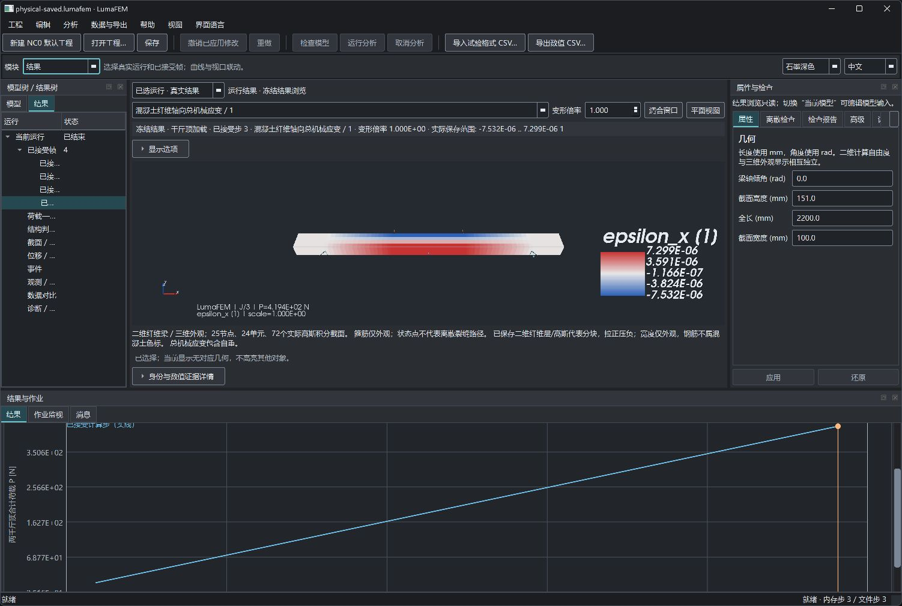
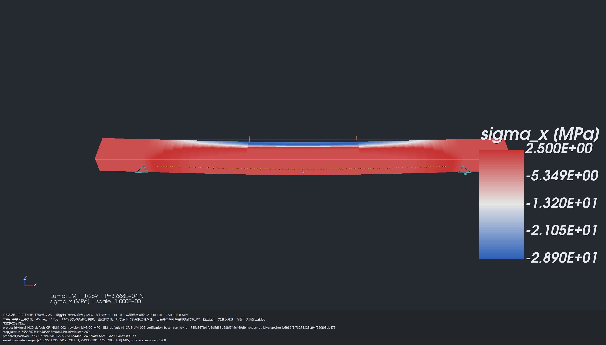
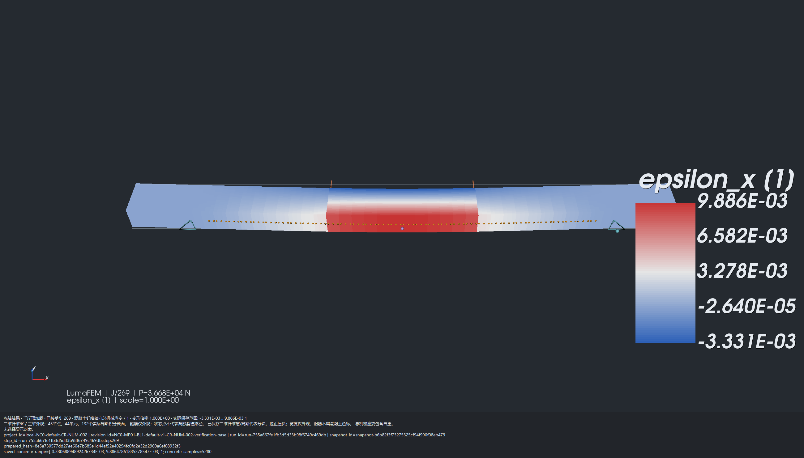
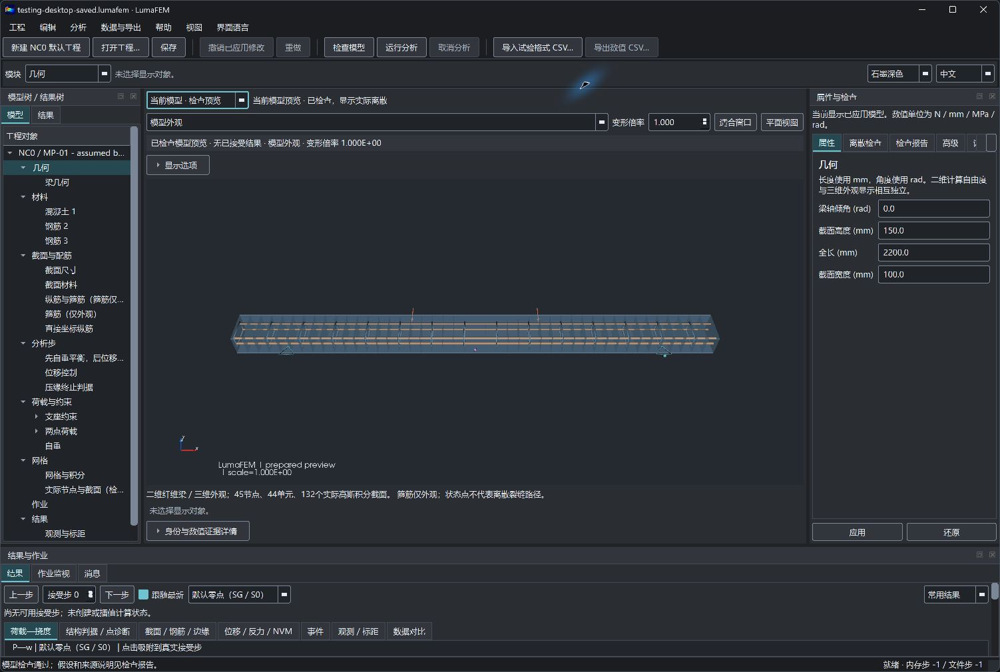

# LumaFEM

LumaFEM 是面向结构研究的 Windows 桌面有限元分析工作台，当前聚焦**钢筋混凝土简支梁两点加载**：参数化建模、非线性分析、接受步与事件浏览、纤维结果后处理，以及 `.lumafem` 工程保存与重开。

采用二维小变形 Euler–Bernoulli 平面纤维梁计算，VTK 提供三维外观显示。当前数值身份为 `0.3.1-cr-num-002-a05`（CR-NUM-002），SQL schema **1**、读取能力 **3**。软件功能验证与科学预测有效性分别报告：已有精确基准构建的 `LIMITED_RESEARCH` 限定研究资格，**原 STRICT 失败、真实试验 C 未验证及其他历史 D 缺口仍保留**，详见下文科学验证限制。

[构建与 CMake 工程说明](docs/CMAKE.md) · [截图来源与显示语义](docs/images/README.md) · [第三方依赖与许可](THIRD_PARTY_NOTICES.md)

## 已实现能力

| 范围 | 当前能力 |
| --- | --- |
| 参数化建模 | 梁几何、混凝土与钢筋材料、截面与配筋、分析步、两点荷载与支承、网格及积分检查；模型树、属性应用/还原、撤销/重做 |
| 非线性计算 | 独立 C++17 核心；Concrete02 型混凝土、双线性硬化钢筋、位移控制与完整 Newton；自重平衡、接受/回退、开裂与屈服事件、参考压缘判据终止 |
| 桌面工作流 | PySide6 Qt Widgets＋VTK；后台计算、协作取消、作业监视、模型/结果选择联动；默认中文及石墨深色，可切换英文和浅色 |
| 结果分析 | 荷载—挠度、截面/钢筋/边缘、位移/反力/内力、事件、观测/标距与数据对比；接受步与曲线、视口联动 |
| 纤维后处理 | 已保存混凝土纤维轴向应力、轴向总机械应变代表分块显示；相机联动 XYZ 箭头；连续物理结果科学计数法及完整精度详情 |
| 输入输出 | CSV 观测映射导入与对比、数值 CSV 及视口/曲线 PNG 导出；SQLite `.lumafem` 逐步事务、保存、重开、另存及恢复副本 |
| Windows 入口 | 带已批准网格/云图/载荷箭头图标的独立 GUI 启动 EXE；Qt 窗口、任务栏和资源管理器图标；保留 PowerShell/CMD 入口 |

核心不依赖 Qt、VTK、Python 或 SQLite；JSON 适配、Python 绑定和桌面存储在核心之外。OpenSees 仅作本地独立参考，不是求解后端或产品运行依赖。软件与 MonsterEngine 独立。

## 真实程序截图

以下图片均复制自已核验的真实程序证据，保持原始字节。示例采用默认建模假设或专用 QA 输入，未做真实试验标定。完整来源、SHA-256 和工况说明见[图片说明](docs/images/README.md)；本地原始工程、科研资料及正式 PDF 不随图片公开。

### 分析界面与结果联动



后处理流水线 `20261109-072002-m9zy` 的**源码程序原生整窗截图**：完整 SHORT QA 工程第 3 接受帧，288 个混凝土样本，显示轴向总机械应变（无量纲）、科学计数法色标、XYZ 方向标与荷载—挠度曲线。SHORT 使用 M100 网格、4 层纤维、不计自重及诊断阈值；它是界面集成工况，不能作为默认 M50 科学分析结果。这张图来自官方源码启动入口，早于图标接入。

### M50 已保存结果：混凝土纤维轴向应力



同一后处理流水线 R3 包内真实 `BeamViewport` **组件导出**：读取原完整 M50 工程第 269 接受帧，每场 5280 个保存样本，变形倍率 1；图中 `P=3.668E+04 N` 是两千斤顶合计荷载。轴向应力单位 MPa，拉正压负，实际范围约 `-2.890E+01 … 2.500E+00 MPa`。该帧为本记录路径的物理标距判据终止状态，不能称为实测极限承载力。它不是完整 M50 主窗口截图，也没有重新求解。

### M50 已保存结果：混凝土纤维总机械应变



同一 M50 帧及导出方式，轴向总机械应变无量纲，**包含自重**，范围约 `-3.331E-03 … 9.886E-03`。两种场均按实际高斯截面/纤维层作最近采样代表分块；宽度拉伸仅构成外观，不是三维实体应力/应变张量场，也不预测离散裂缝路径。色标逐帧使用实际范围，白色表示范围中点，不保证为零；不能直接跨帧比较颜色。局部纤维应变与固定物理标距平均判据是不同量。

### 图标版桌面工作台



图标流水线 `20261109-125223-priw` 的真实 Windows 整窗截图，由实际 `LumaFEM.exe` 启动。此时仅有已检查的默认模型预览，**没有分析结果**；标题栏使用已批准图标。图标本身是品牌示意。资源管理器与全桌面原始截图含个人目录及其他应用内容，未纳入公开图片。

另附 [SHORT 主窗口所属视口导出](docs/images/short-mainwindow-viewport-strain.png)：同为第 3 帧、288 样本，由正常控制器打开已保存工程后导出，仅含结果视口与来源说明，既不是原生整窗，也不是 M50 组件图。

## 环境与依赖

当前验证平台是 Windows x64、CPython **3.10 x64**、MSVC x64 C++ 工具链及 Windows SDK（含资源编译器和 `dumpbin.exe`）。其他平台未建立桌面交付验证。

| 层次 | 固定依赖 |
| --- | --- |
| 构建 | CMake 3.30.5、Ninja Python 包 1.11.1.1；根工程声明 CMake ≥3.24，预设文件格式为 version 6，推荐使用安装脚本固定版本 |
| 核心与适配 | Eigen 3.4.0、nlohmann/json 3.11.3（适配层）；官方归档 SHA-256 校验 |
| 绑定与界面 | pybind11 2.13.6、PySide6/shiboken6 6.7.3、VTK 9.3.1、NumPy 1.26.4、Matplotlib 3.9.2 |
| 存储 | CPython 标准库 SQLite；独立于 C++ 核心 |

完整固定版本见 [requirements-desktop.txt](requirements-desktop.txt)，依赖边界、选项与目标关系见 [docs/CMAKE.md](docs/CMAKE.md)。

## 从源码构建与启动

在仓库根目录的 PowerShell 中执行，示例 Python 路径请换为本机 CPython 3.10 x64：

```powershell
./scripts/bootstrap.ps1 -Python 'C:/Python310/python.exe'
./scripts/build.ps1 -Jobs 3
```

安装脚本建立 `.venv/`、安装固定依赖并缓存 Eigen/JSON 归档。构建脚本自动查找并初始化 MSVC x64 环境；找不到时可传 `-VisualStudioPath`。常规构建生成核心、CLI、Python 绑定、测试程序，并单独构建 GUI 启动器及其来源清单；`-CoreOnly` 关闭绑定并跳过 GUI 启动器，仍构建 CLI 和启用的原生测试。

**公开仓库不附带本地科研案例或完整回归夹具。** 桌面启动需要有效 `.lumafem` 工程或含 `NC0.json` 的案例目录：

```powershell
./scripts/launch.ps1 -Project 'D:/projects/example.lumafem'
# 或：
./scripts/launch.ps1 -CaseDir 'D:/cases/example'
./build/bin/lumafem_cli.exe --help
```

已有本地种子 `development_doc/runtime/NC0.json` 时，才可运行以下生成步骤；默认目标已有输入时应跳过：

```powershell
./.venv/Scripts/python.exe ./scripts/provision_local_data.py
./scripts/launch.ps1
```

生成器默认写入 `development_doc/runtime/CR-NUM-002`，拒绝覆盖已有 CR-NUM-002 输入，不改旧种子/CR1 目录。它派生显式数值修订并生成**合成**对比 CSV，不会凭空创建缺失的科研种子；默认值、建模假设和合成数据不等于实测或独立数值证据。

日常操作为：编辑属性并应用 → 检查模型 → 提交分析 → 浏览已接受帧 → 保存/导出。F6 检查、F5 提交、Shift+F5 请求取消；Ctrl+Enter 应用、Ctrl+S 保存、Ctrl+Shift+S 另存。视口有焦点时 F 适合窗口、Shift+F 平面视图、Esc 清除选择。语言/主题切换保留草稿、帧、变量及相机，仅影响会话显示。

## 测试与已验证范围

当前 GUI 主体、后处理、图标三条流水线均已正式 **COMPLETE**，独立评审 **APPROVE**、最终证据核验 **PASS**；本轮文档整理没有重跑或重标这些流水线。

| 已完成范围 | 流水线 | 最终完整 CTest 回归 |
| --- | --- | --- |
| GUI 主体 | `20261108-182129-u8d4` | 19/19；含真实 GUI 完整 270 状态、保存重开及同核状态/CSV 等价证据 |
| 纤维后处理、方向轴及科学格式 | `20261109-072002-m9zy` | 20/20；后处理目标实际执行 10 个测试方法 |
| 图标与独立 Windows 启动器 | `20261109-125223-priw` | 22/22；新增图标/启动器共 7 个测试方法，含实际 Windows、迁移包及故障验证 |

这些是已封存的本地验证结果，不是测试覆盖率百分比或公开 CI 徽章。流水线报告和原始日志保存在忽略的本地 `specs/`；本地两份正式图文 PDF 为 14 页过程记录及 13 页结果分析，归档 COMPLETE 共 663 项，不自动公开。

需要执行测试时，在已有夹具的独立验证工作区使用：

```powershell
./.venv/Scripts/ctest.exe --preset windows-release --show-only
./.venv/Scripts/ctest.exe --preset windows-release --output-on-failure
```

全套测试引用本地 `specs/`、`development_doc/` 输入并有输出副作用，不能在封存证据上直接重跑。全新克隆缺少这些输入时不能声称全套可复现通过；无需科研夹具的原生检查及细节见 [CMake 测试说明](docs/CMAKE.md#测试与本地夹具)。历史方向标关闭失败、原 300 秒外层超时及旧语义评审 BLOCK 继续保留；仅 `physical_extended` 外层 watchdog 经独立评审改为 600 秒，数值预算及原断言不变，不构成性能资格。

## 本地打包与 EXE 启动

完成同源构建后，在 **MSVC x64 开发环境**中运行：

```powershell
./scripts/package.ps1
# 仅在明确需要复制本地默认/合成案例时使用：
./scripts/package.ps1 -CaseDir ./development_doc/runtime/CR-NUM-002
```

脚本只创建新的 `dist/LumaFEM-CR-NUM-002-GUI-ICON-*` 目录，拒绝覆盖旧包，默认不复制科研案例。包内含 Python 运行时、原生模块、GUI 依赖、许可证及文件哈希清单；失败包保留 `INCOMPLETE.txt`。打包严格核对 Ninja 无待构建、源码时间、绑定身份、受保护 CLI/PYD 精确哈希及启动器来源；其他工具链产生的不同原生哈希可能被拒绝，不能绕过保护将其称为已验证包。CMake `install` 只是部分原生产物安装，不能替代桌面打包。

当前本地已验证入口为：

```text
dist/LumaFEM-CR-NUM-002-GUI-ICON-20261109-125223-priw-v1 relocated 图标/LumaFEM.exe
```

**移动时保留整个包目录。** 可双击 EXE；无内置案例时传入工程或案例。在包目录的 PowerShell 中：

```powershell
& './LumaFEM.exe' -Project 'D:/projects/example.lumafem'
& './LumaFEM.exe' -CaseDir 'D:/cases/example'
```

EXE 经系统 PowerShell 委托包内 Python GUI，等待正常关闭并返回子进程退出码；相对路径按调用者工作目录解析。保留 `Launch-LumaFEM.ps1` / `LumaFEM.cmd` 以便启动和诊断。单独的 `build/windows_launcher/bin/LumaFEM.exe` 是待组装启动器，需要包的相邻脚本和运行时；源码桌面使用 `launch.ps1`。没有安装器、文件关联或任务栏固定保证；包组装成功不构成科学验收。

## 工程保存与兼容性

`.lumafem` 使用 SQLite，结果绑定冻结输入修订；保存包含逐步事务与恢复副本，重开结果不等于从任意接受步续算。完整默认工程保存/读取耗时明显，尚无性能资格。

SQL schema1 与读取能力3是不同版本轴。新读者兼容能力1/2，写入须保护能力3数值语义。已知旧 0.2.0/0.2.1/0.2.2 与 0.3.0 冻结快照先核验原哈希及完整版本描述，再分析只读；重新分析须显式新修订/重新准备。旧 0.1 按原算法兼容，源 JSON 缺失判据仍是 legacy 点式语义，不能合并新默认、静默升级或补造历史窗口证据。

CLI 的只读核验针对冻结 prepared 快照，不直接读取 SQLite 工程；`view` 不运行求解或接受设置覆盖，输出须为新目录：

```powershell
./build/bin/lumafem_cli.exe --mode view --input 'D:/projects/prepared.json' --output ./out/unique-view
```

## 科学验证限制

- 当前 `physical_gauge_mean_v1` 是**未标定的助手建模假设**：兼容 EB 位移场，对整梁上下双边缘所有完整机械窗口的平均总应变计算最大压缩量，包含自重，独立于显示传感器、显示零点与 Gauss 采样。旧 `route_c_point_v1` 保留，新模式的旧点压碎标记仅为诊断；不提供压碎后残余段。
- 原 STRICT 的 10% / 95% / 独立 2% 门槛实际失败。用户授权放宽后，助手选定 LIMITED_RESEARCH 的空间端位移 25% / 双全程 80% 政策上限；这不是统计置信区间，也没有移除其他原精度、物理终点、时间、能量和兼容关口。旧 BL1、CR1 及首轮 CR2 FAILED/WITHHELD 不追认通过。
- A（材料/解析与固定离散参考）和 B（离散/积分/路径敏感性）的证据只能按精确输入、策略与构建身份解释。限定基准资格不赋予任意工程 B 通过，不证明网格客观性、唯一或稳定分支、真实裂缝宽度、真实试验压碎标定或一般工程预测有效性。
- C（真实试验验证）仍未验证；默认参数、合成 CSV 和同核重放不能替代真实试验或独立求解证据。D（桌面与持久化）已有本轮范围内通过记录，其他无新证据的历史时序/响应等缺口仍部分未完成。未认证性能。

本地详细需求、评审、科研材料、PDF、案例与封存证据继续保存在忽略目录，不随 GitHub 展示公开。公开构建说明见 [docs/CMAKE.md](docs/CMAKE.md)，图片来源见 [docs/images/README.md](docs/images/README.md)。
